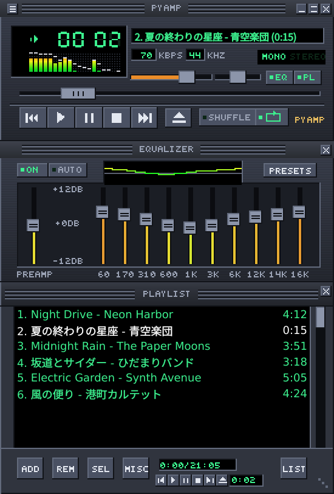

# PYAMP

**Ubuntu で使える、Winamp 2 風の音楽プレイヤー**

小さくまとまった画面、キーボードだけで操作できる手軽さ、着せ替えスキン、曲に合わせて動く模様（ビジュアライザー）。
あの頃の Winamp の使い心地を、今の Ubuntu で。



*A Winamp 2–style music player for Ubuntu, written in Python + PySide6 + GStreamer. Supports classic Winamp skins (.wsz), a 10-band EQ, playlist with drag & drop, Winamp keyboard shortcuts and a MilkDrop-like visualizer.*

## 主な機能

- **Winamp 2 と同じ配置の画面**：メイン・イコライザー・プレイリスト。1倍・2倍・3倍の表示サイズ
- **Winamp のスキン（.wsz）がそのまま使える**：画面にドラッグ＆ドロップするだけ
- **10バンドのイコライザー**（60Hz〜16kHz、Winamp と同じ周波数）、プリアンプ、プリセット12種、曲ごとに覚える AUTO
- **プレイリスト**：ファイルやフォルダのドラッグ＆ドロップ、並べ替え、曲の長さと合計時間、m3u の保存/読込
- **曲名で探してジャンプ**（J キー）：ひらがな/カタカナ・全角/半角を区別せずに検索
- **MP3 タグの表示**：古い Shift_JIS のタグも文字化けせずに表示
- **ビジュアライザー**（Ctrl+Shift+K）：曲に合わせて動く MilkDrop 風の模様。8種類、全画面対応
- **Winamp と同じキー操作**：Z / X / C / V / B など


## インストール

対象：**Ubuntu 25.04 以降**（Ubuntu 26.04 LTS で動作確認）

1. [Releases](https://github.com/kenjiiida-commits/PYAMP/releases) から `pyamp_<バージョン>_all.deb` をダウンロード
2. 端末で、ダウンロードしたフォルダに移動して実行

   ```bash
   sudo apt install ./pyamp_1.3.3_all.deb
   ```

   （ファイルをダブルクリックして「アプリセンター」からインストールしても OK です）
3. アプリ一覧から **PYAMP** を起動

必要な部品（PySide6、GStreamer など）は Ubuntu の公式パッケージから自動で入ります。
アンインストールは `sudo apt remove pyamp` です。

## 使い方

| 操作 | キー |
|---|---|
| 前の曲 / 再生 / 一時停止 / 停止 / 次の曲 | Z / X / C / V / B |
| ファイルを開く / フォルダを追加 | L / Shift+L |
| シャッフル / リピート | S / R |
| 5秒戻る / 5秒進む | ← / → |
| 音量 | ↑ / ↓ |
| イコライザー / プレイリストの表示切り替え | Alt+G / Alt+E |
| 曲名で探してジャンプ | J |
| ビジュアライザー | Ctrl+Shift+K |
| 選んだ曲を一覧から外す | Delete |
| 終了 | Ctrl+Q |

- 曲やフォルダを **プレイリストにドラッグ** → 追加／**メイン画面にドラッグ** → 入れ替えてすぐ再生
- 時間表示をクリック → 残り時間表示／タイトルバーをダブルクリック → 表示サイズの切り替え
- プレイリストの右下をドラッグ → 高さを変える
- 右クリック → メニュー（スキン、表示サイズ、キー操作の一覧など）
- 設定とプレイリストは終了時に自動で保存されます（`~/.config/pyamp/`）

### ビジュアライザー

Ctrl+Shift+K、右クリックメニュー、または左上の小さなスペクトラムをダブルクリックで開きます。

| キー | 動き |
|---|---|
| F / Enter / ダブルクリック | 全画面の切り替え |
| Space / → | 次の模様 |
| ← | 前の模様 |
| L | 今の模様で固定（ロック） |
| H | 操作の説明 |
| Esc | 全画面をやめる／閉じる |

### スキン

Winamp 2 用のスキン（`.wsz`）が使えます。[Winamp Skin Museum](https://skins.webamp.org/) などで探して、ダウンロードした `.wsz` を PYAMP の画面にドラッグ＆ドロップしてください。
追加したスキンは `~/.config/pyamp/skins/` に保存され、右クリック →「スキン」から切り替えられます。

- スキンに足りない部品があるときは、内蔵スキンの絵で補います
- ウィンドウの形を変える設定（region.txt）にはまだ対応していません
- 各スキンの著作権は、それぞれの作者にあります（PYAMP にはスキンを同梱していません）

## ソースから動かす・DEB を作る

```bash
sudo apt install python3-gi gir1.2-gstreamer-1.0 gir1.2-gst-plugins-base-1.0 \
     gstreamer1.0-plugins-good gstreamer1.0-pulseaudio \
     python3-pyside6.qtwidgets python3-pyside6.qtopengl python3-pyside6.qtopenglwidgets
python3 pyamp/main.py            # 起動
./packaging/build_deb.sh         # dist/ に DEB ができる
```

### ファイルの役割

| ファイル | 中身 |
|---|---|
| `pyamp/main.py` | 起動するところ |
| `pyamp/window.py` | 全体のまとめ役。ボタンの動作・キー操作・メニュー・設定の保存 |
| `pyamp/player.py` | 再生エンジン（GStreamer）。再生・EQ・バランス・スペクトラム解析 |
| `pyamp/main_panel.py` | メイン画面（時間・曲名・スペクトラム・ボタン・スライダー） |
| `pyamp/equalizer.py` | イコライザー画面とプリセット |
| `pyamp/playlist.py` | プレイリスト画面 |
| `pyamp/jump.py` | 曲にジャンプ（J キー）の検索画面 |
| `pyamp/trackinfo.py` | 曲の長さ・タグを裏で調べて保存する係 |
| `pyamp/textfix.py` | Shift_JIS で書かれた古いタグの文字化けを直す |
| `pyamp/visualizer.py` | ビジュアライザー（GPU で描く MilkDrop 風の模様） |
| `pyamp/skinwidget.py` | スキン画像で描く画面の土台（クリック・ドラッグの判定） |
| `pyamp/skin.py` | スキン（.wsz）の読み込みと文字の描画 |
| `pyamp/sprites.py` | Winamp スキンの座標表（どの絵がどこにあるか） |
| `pyamp/default_skin.py` | 内蔵スキン「PYAMP 標準」をコードで描く |
| `packaging/` | DEB パッケージを作るためのファイル |

## 注意

- PYAMP は Winamp の公式ソフトではなく、Winamp の開発元とは関係のない個人の作品です。Winamp は各権利者の商標です。
- 内蔵スキン「PYAMP 標準」の絵、ビジュアライザーの模様は、すべてこのソフトのためのオリジナルです。

## 謝辞

- スキン画像の座標は、Winamp 互換プレイヤー [Webamp](https://github.com/captbaritone/webamp)（MIT ライセンス）の資料を参考にしました
- 音の再生には [GStreamer](https://gstreamer.freedesktop.org/)、画面には [Qt for Python (PySide6)](https://www.qt.io/qt-for-python) を使っています

## ライセンス

[MIT License](LICENSE) © 2026 飯田顕治 (Kenji Iida)
